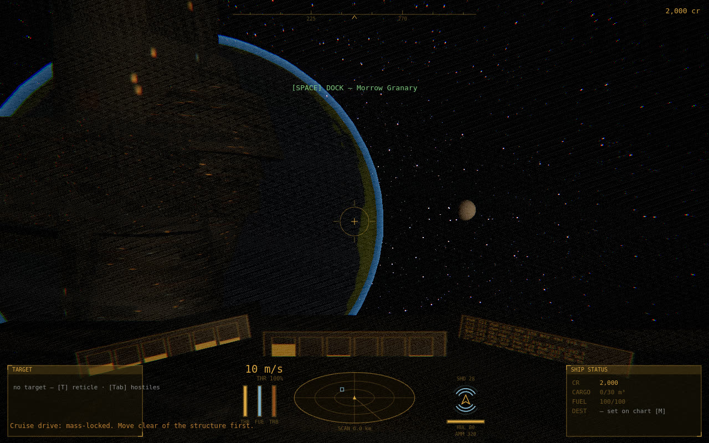
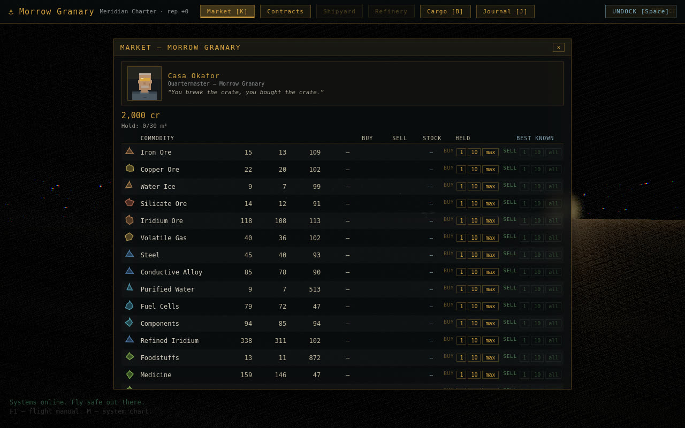
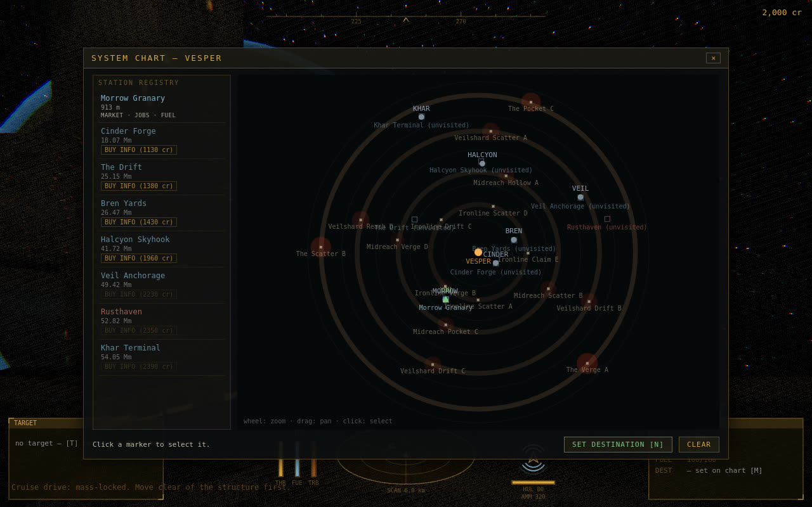
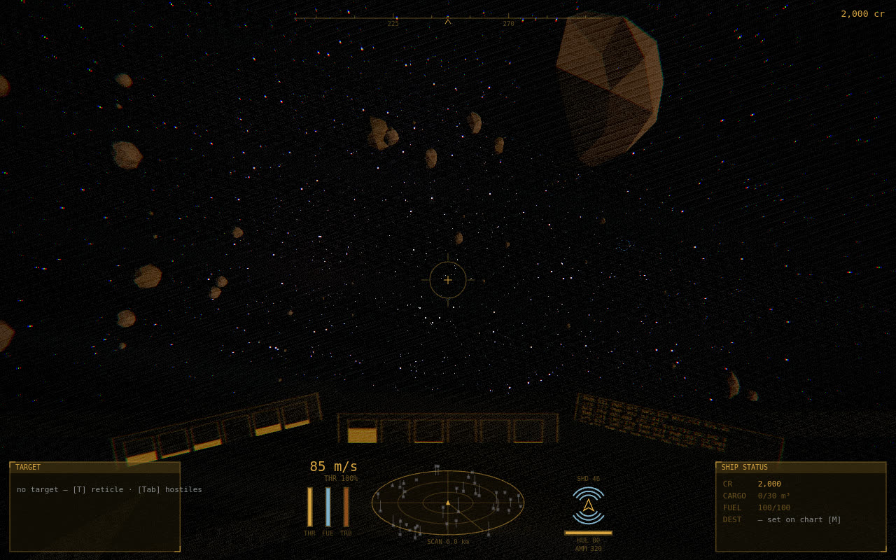
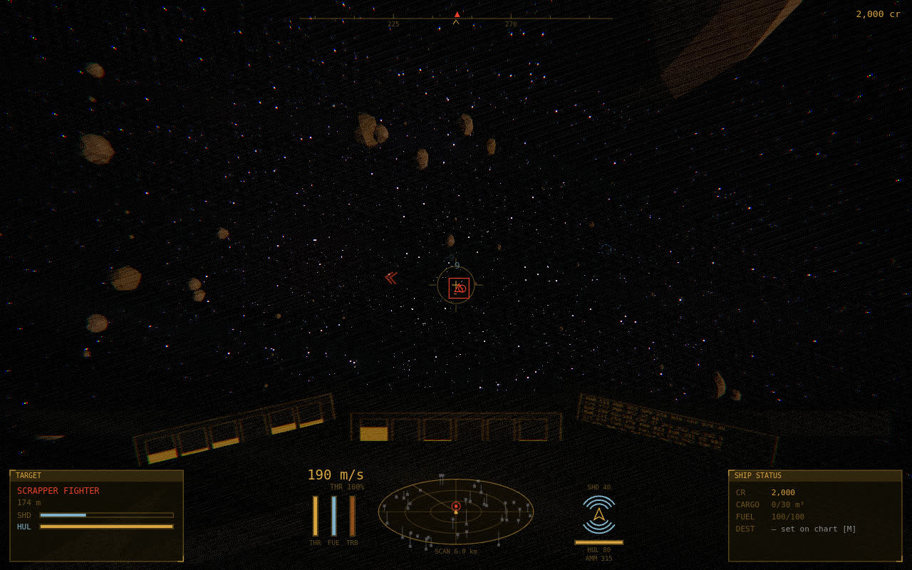
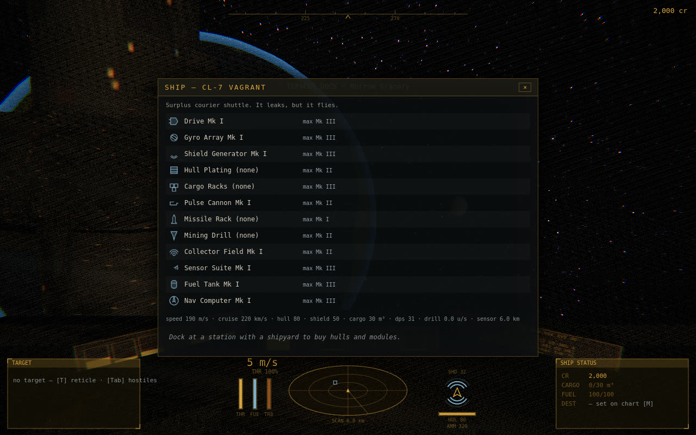
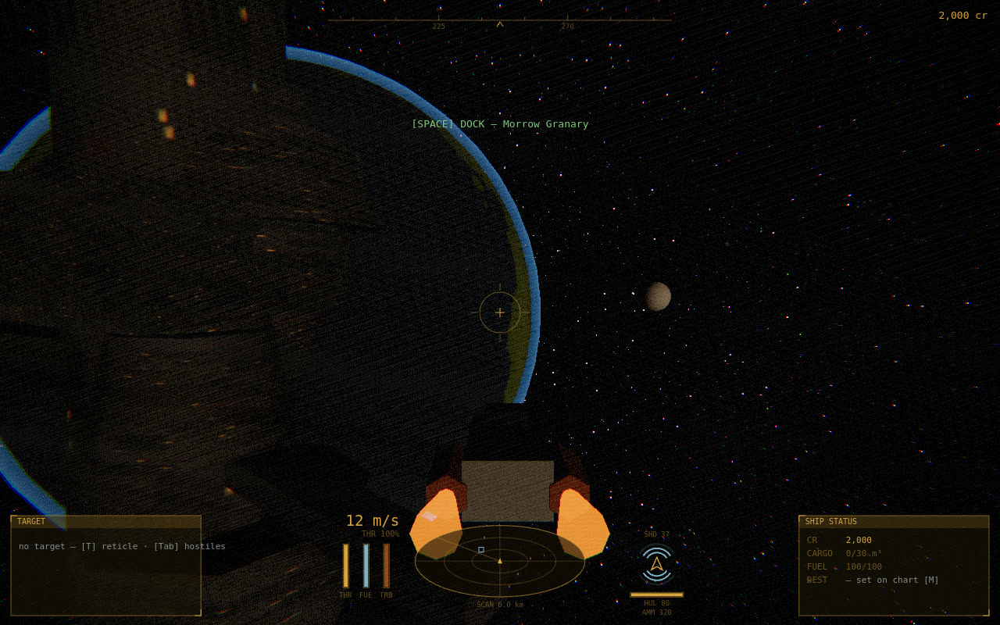
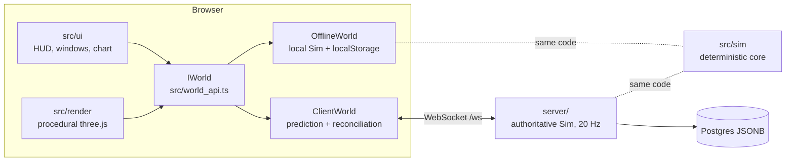

# Void Freighter

A gritty multiplayer space-hauling sim that runs in the browser. Haul freight, work trade routes, mine asteroids and survive pirate ambushes in the Vesper system.



Ships, planets, stations, asteroids, UI icons, post-processing and sound are all generated in code at runtime. The game ships no image, model or audio files.

## How it plays

- **Haul**: take transport contracts from station boards and deliver before the deadline.
- **Trade**: buy where goods are produced, sell where they are consumed. Prices react to supply, demand and your own orders.
- **Mine**: crack rocks in four asteroid belts, scoop the fragments, refine the ore.
- **Fight**: pirates patrol red zones and interdict rich cargo. Their wrecks drop loot and modules.
- **Upgrade**: 5 hulls and 12 module types (engine, shield, drill, scanner and more) across 5 tiers.
- **Lose things**: death costs your cargo and an insurance deductible. Fuel is finite.

All players share one star system and one economy, so every trade moves the same prices. Stations are safe; deep space is not.

<table>
  <tr>
    <td></td>
    <td></td>
  </tr>
  <tr>
    <td align="center">Station market</td>
    <td align="center">System chart</td>
  </tr>
  <tr>
    <td></td>
    <td></td>
  </tr>
  <tr>
    <td align="center">Asteroid field</td>
    <td align="center">Pirate dogfight</td>
  </tr>
  <tr>
    <td></td>
    <td></td>
  </tr>
  <tr>
    <td align="center">Ship modules</td>
    <td align="center">Chase camera</td>
  </tr>
</table>

## Quick start (solo)

```bash
npm install
npm run dev          # open http://localhost:5173 and press LAUNCH
```

Solo mode runs the full simulation in the browser and saves to localStorage. You start docked: check the market (`K`), take a contract, undock (`Space`), pick a destination on the chart (`M`, then `N`) and engage cruise with `Caps Lock`. `F1` opens the flight manual.

## Offline web build

Solo mode needs no server, so the client can be published on any static host.

```bash
npm run build        # static client -> dist/, relative paths
npm run preview      # or serve dist/ with any static server
```

`dist/` works from any sub-path. The ONLINE panel needs a game server on the same origin (`/api`, `/ws`). On a static host the menu detects that there is none and disables LOG IN and REGISTER.

For itch.io:

```bash
npm run build:itch   # -> release/void-freighter-<version>-itch-html5.zip
npm run verify:itch  # serves the zip in an iframe sub-path and launches it in headless Chrome
```

The itch build is offline only: the ONLINE panel and all `/api` and WebSocket code are compiled out, and `build:itch` fails if any network code or root-absolute path is left. Upload the zip as an HTML project played in the browser, with a viewport of 1280×720 or larger.

## Multiplayer server

There is no official public server. These steps run your own.

```bash
npm run build        # client -> dist/
npm run server       # http://localhost:8788, in-memory DB if no Postgres is configured
```

With Docker and a persistent Postgres:

```bash
cp .env.example .env # set POSTGRES_PASSWORD
docker compose up -d --build
# open http://localhost:8788
```

For internet hosting, put a TLS reverse proxy in front. The game container binds to loopback only, the WebSocket lives at `/ws`, and the client switches to `wss://` on https pages. Caddy example:

```
game.example.com {
    reverse_proxy 127.0.0.1:8788
}
```

- Accounts use scrypt password hashes, expiring bearer tokens and per-IP rate limiting.
- Player and market state are stored as JSONB in Postgres, autosaved every 30 s, on logout and on shutdown.
- `ALLOW_DEV_COMMANDS=1` enables teleport and credit cheats for test bots. Never set it in production.

## Controls

Keyboard bindings can be changed in-game. HOTAS and gamepads are supported through the browser Gamepad API.

| Key | Action |
|---|---|
| `W` / `Shift` | Throttle up |
| `S` / `Ctrl` | Throttle down (hold past zero to brake) |
| `Caps Lock` / `X` | Cruise drive / cut throttle |
| `A` `D` `R` `F` | Strafe |
| `Q` `E` / mouse | Roll / pitch and yaw |
| `Z` | Flight assist |
| Left / right mouse | Cannon / missile (when locked) |
| `Tab` / `T` | Cycle hostiles / target reticle |
| `G` / `Space` / `H` | Mining drill / dock and undock / rescue tow |
| `M` `B` `C` `J` `K` `L` | Chart, cargo, ship, journal, market, contacts |
| `N` / `V` / `Enter` / `F1` | Set destination / camera / chat / help |

## How it works



- `src/sim/` is the deterministic core (flight, economy, combat, mining, AI, loot) with no DOM access. The same code runs in the browser for solo play and on the server for multiplayer.
- Rendering and UI only talk to `IWorld`, so they don't know whether they're offline or online.
- The world seed is fixed (`WORLD_SEED` in `src/sim/system.ts`), so every client generates the same Vesper system and only dynamic state crosses the wire. Asteroid fields sync as damage deltas on top of local generation.

| Path | Contents |
|---|---|
| `src/sim/` | Simulation core |
| `src/render/` | three.js scene: bodies, ships, asteroids, effects, post-processing |
| `src/game/` | Input, cameras, WebAudio synth, gamepad, app orchestrator |
| `src/ui/` | Canvas HUD and radar, system chart, station windows, chat, menu |
| `src/net/` | Network protocol and `ClientWorld` |
| `server/` | HTTP auth, WebSocket world, Postgres persistence (in-memory fallback) |
| `tests/`, `scripts/` | Vitest specs; smoke bots and headless-browser tours |

Balance numbers and the reasoning behind them are in [docs/design/BALANCE.md](docs/design/BALANCE.md). The original design document (Spanish) is [DESIGN.md](DESIGN.md).

## Development

```bash
npm test             # vitest: physics, economy, combat, mining, contracts, server auth/WS/persistence
npm run typecheck
npm run smoke        # trade, mining and combat bots against the real sim
npm run tour         # headless-browser screenshot tour (needs Chrome/Chromium, or set CHROME_BIN)
npm run tour:online  # two browser clients against the real server
npm run playtest     # a full contract run driven by inputs only: accept, fly, dock, get paid
npm run media        # cruise time-lapse GIF in screenshots/ (needs ffmpeg)
```

The browser scripts use a separate dev-tools build (`npm run build:e2e` -> `dist-e2e/`) that exposes the `window.VF` hook. The dev server has it too; the public `npm run build` does not.

Tech stack: TypeScript, three.js, Vite, Node (`ws`), PostgreSQL 16, Vitest, Docker.

## Status

Early version (0.1.0). Playable solo and online.

Bugs, ideas and balance complaints are welcome on the [issue tracker](https://github.com/imelero-dev/void-freighter/issues).

## License

[MIT](LICENSE)
