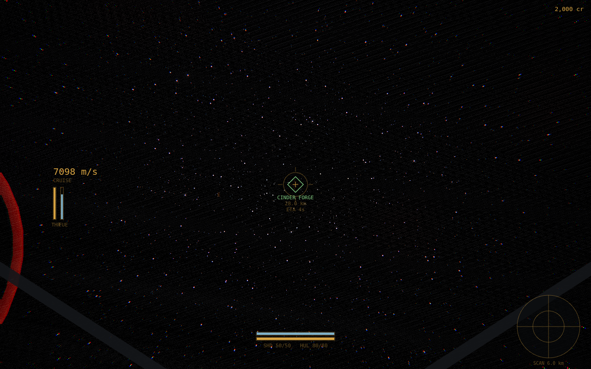
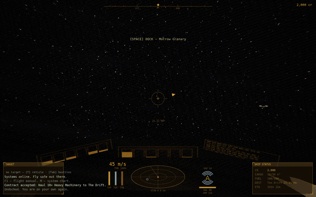
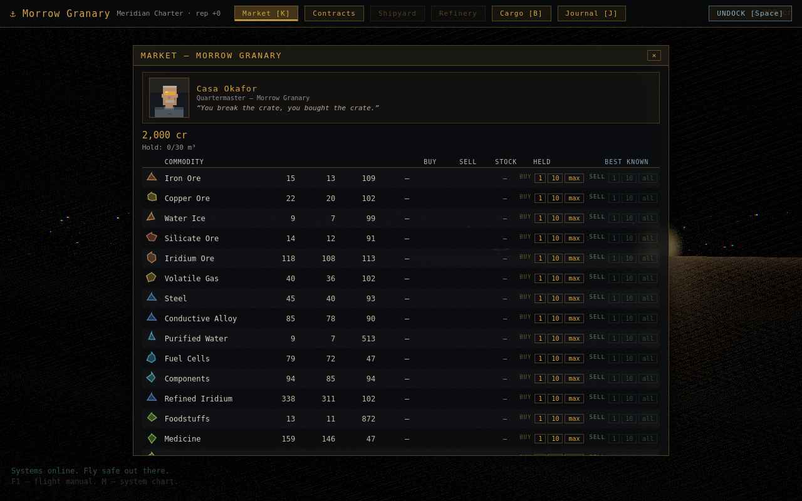
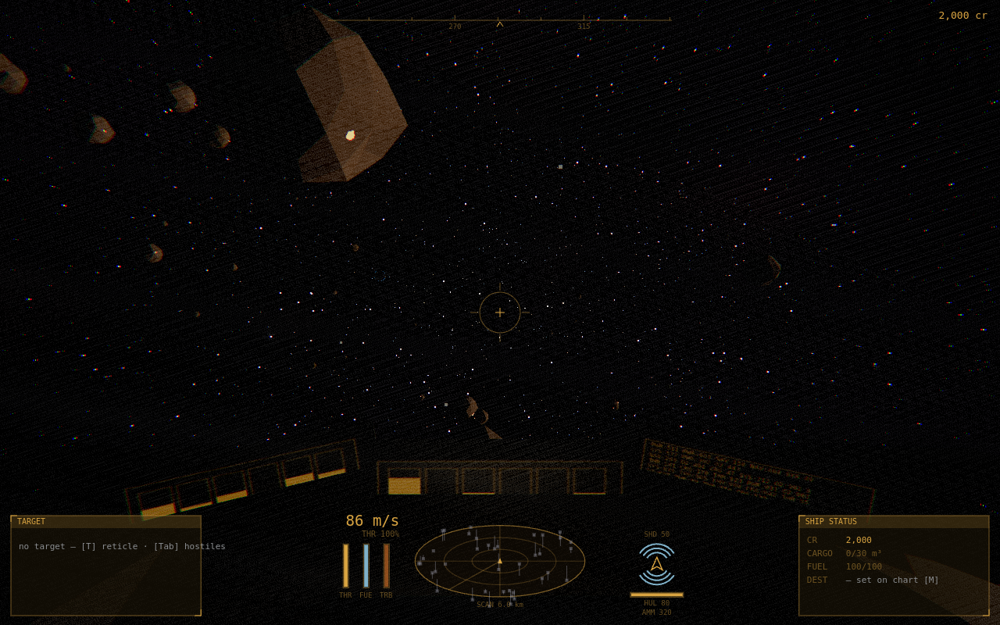
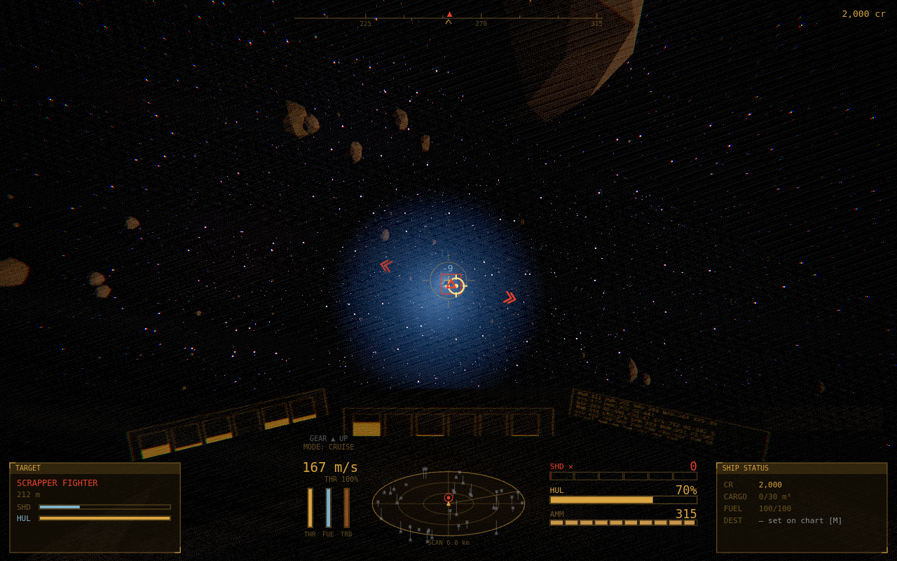

# VOID FREIGHTER

**A gritty space-hauling sim that runs in your browser: haul freight, chase
arbitrage, crack asteroids and survive pirate ambushes in the Vesper system.**



*Euro Truck Simulator in space + Elite Dangerous lite + a living EVE-style
economy.* **Everything is procedural**: ships, planets, stations, asteroids,
UI icons, post-processing and every sound are generated from code at runtime.
The game loads no image, audio, model or font files. The only binary files
in the repo are the screenshots and GIF in `screenshots/`.

## Play

There is no hosted demo yet. The **solo (offline) mode** is the full game,
running entirely in your browser with no account or server needed:

- **From source:** `npm install && npm run dev`, open http://localhost:5173
  and press LAUNCH (see [Quick start](#quick-start-offline)).
- **Offline web build:** `npm run build` (or `npm run build:itch` for a
  ready-to-upload zip) and serve the folder from any static host
  (see [Publishing the offline build](#publishing-the-offline-build)).

Multiplayer is **self-hosted only**. There is no official public server: to
play online you run your own (see [Multiplayer server](#multiplayer-server-self-hosted)).

## How it plays



- **Haul** — take transport contracts from station boards, beat the deadline.
- **Trade** — buy cheap at producers, sell dear at consumers. Prices move with
  supply/demand, your own orders included, and revert over time.
- **Mine** — crack rocks in four asteroid belts, scoop fragments, refine ore.
- **Fight** — pirates patrol red zones and interdict rich cargo. Loot pays.
- **Upgrade** — 5 hulls and 12 module families across 5 tiers.
- Death loses your cargo and an insurance deductible. Fuel is finite. The void
  does not care about you.

One shared star system, one shared economy: every player's trades move the
same prices. Stations are safe ground; deep space is not.

| | | |
|---|---|---|
|  |  |  |
| Docked: market, contracts, shipyard | Mining in an asteroid belt | Pirate interdiction |

## Controls

| Key | Action |
|---|---|
| Shift / W | throttle up (gradual) |
| Ctrl / S | throttle down — hold past zero to brake |
| Caps Lock | cruise drive ("hypervelocity") · X cut throttle |
| A D R F | strafe · Q E roll · mouse pitch/yaw · Z flight assist |
| LMB / RMB | cannon / missile (when locked) |
| Tab / T | cycle hostiles / target reticle |
| G | mining drill · Space dock/undock · H rescue tow |
| M B C J K L | map · cargo · ship · journal · market · contacts |
| N / V / Enter / F1 | set destination · camera · chat · help |

F1 in game shows the full flight manual; F2 rebinds keys and sets up HOTAS.

## Quick start (offline)

```bash
npm install
npm run dev          # http://localhost:5173 — press LAUNCH
```

Offline play runs the full simulation in your browser and saves to
localStorage. `F1` shows the flight manual. Start docked, check the market
(K), grab a contract, undock (Space), set a destination on the chart (M) and
engage the cruise drive with Caps Lock.

### Publishing the offline build

```bash
npm run build        # static client -> dist/ (index.html + assets/)
```

`dist/` is a self-contained static folder with relative paths (`base: './'`),
so it can be served from any static host or sub-path, no backend needed. Test
it locally with any simple static server, e.g.:

```bash
npm run preview                              # http://localhost:4173
# or
python3 -m http.server 8080 --directory dist # http://localhost:8080
```

Press LAUNCH in the SOLO panel. The ONLINE panel needs a game server on the
same origin (`/api`, `/ws`); on a static host the menu detects that there is
none and disables LOG IN / REGISTER.

**itch.io (HTML5):**

```bash
npm run build:itch   # -> release/void-freighter-<version>-itch-html5.zip
npm run verify:itch  # unzip + serve in an iframe sub-path + launch in headless Chrome
```

The itch build is offline-only: the ONLINE panel and all `/api` / WebSocket
code are compiled out, so it makes no network requests. `index.html` sits at
the zip root and all paths are relative. `build:itch` fails if the package
breaks itch.io's HTML5 rules (file count and size limits, root-absolute
paths, leftover network code). On itch.io, create an HTML project, upload
the zip, tick "This file will be played in the browser", and set the
viewport to 1280×720 or larger with the fullscreen button enabled.
`verify:itch` needs Chrome or Chromium (set `CHROME_BIN` if it is not found).

## Multiplayer server (self-hosted)

There is no official public server — these steps run your own.

```bash
npm run build        # client -> dist/
npm run server       # http://localhost:8788 (in-memory DB without Postgres)
```

With Docker (persistent Postgres):

```bash
cp .env.example .env # set POSTGRES_PASSWORD
docker compose up -d --build
# open http://localhost:8788
```

For internet hosting put a TLS reverse proxy in front (the WebSocket lives at
`/ws`; the client auto-selects `wss://` on https pages). Caddy example:

```
game.example.com {
    reverse_proxy 127.0.0.1:8788
}
```

Notes:
- Accounts: scrypt password hashes, 7-day bearer tokens, per-IP rate limiting.
- The game container publishes on loopback only; the proxy is the public door.
- `ALLOW_DEV_COMMANDS=1` enables teleport/credits cheats for test bots —
  never set it in production.
- Player state is JSONB in Postgres, autosaved every 30 s, on logout and on
  shutdown. Market state persists too.

## Development

```bash
npm test             # 70 vitest tests: physics, economy, combat, mining,
                     # contracts, auth/WS/persistence/anti-dupe
npm run typecheck
npm run smoke        # trade / mine / combat bot runs against the real sim
npm run tour         # headless-browser screenshot tour (needs Chromium)
npm run tour:online  # 2 real browser clients vs the real server
npm run playtest     # a full contract run, inputs only: accept, fly, dock, get paid
npm run media        # README GIF: undock -> cruise time-lapse (needs ffmpeg)
```

Architecture (mirrors the `world-of-claudecraft` stack):

```
src/sim/      deterministic core — flight, economy, combat, mining, AI, loot.
              No DOM. Same code runs offline (browser) and in the server.
src/render/   three.js, all procedural: bodies, ships, asteroids, fx, post
src/game/     input, cameras, WebAudio synth, orchestrator
src/ui/       canvas HUD + radar, system chart, station windows, chat, menu
src/net/      protocol + ClientWorld (prediction/reconciliation mirror)
src/world_api.ts  IWorld — render/UI never know if they're offline or online
server/       HTTP auth + WS world + Postgres JSONB (in-memory fallback)
tests/        vitest; scripts/ smoke bots + browser tours
docs/design/  balance numbers & design decisions
```

World seed is fixed (`WORLD_SEED` in `src/sim/system.ts`): the Vesper system
is the same place for every client, so only dynamic state crosses the wire —
asteroid fields sync as damage deltas over deterministic local generation.

## Feedback

Bugs, ideas and balance complaints are welcome on the
[issue tracker](https://github.com/imelero-dev/void-freighter/issues).

## License

MIT — see [LICENSE](LICENSE). The original design document (in Spanish) is
[DESIGN.md](DESIGN.md).
